# Project Director / photo-editor

A non-destructive, AI-native photo, video, audio, and motion editor.

This repository hosts **two parallel editor tracks** built around a shared
deterministic philosophy: original media is never modified, mutations pass
through validated command models, and project states replay byte-for-byte.

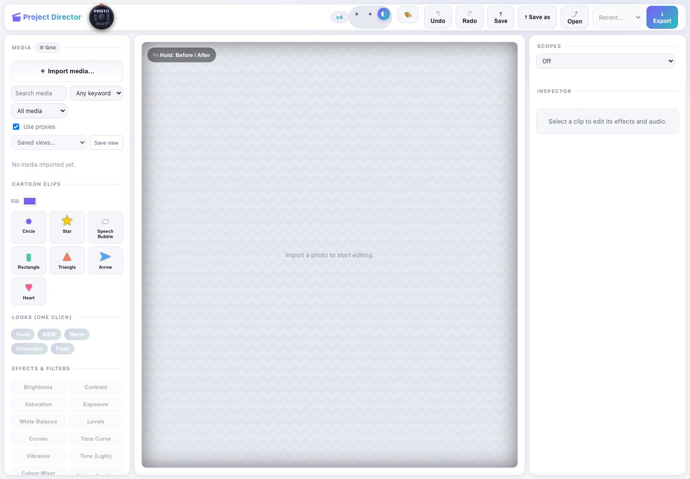

---

## Track 1 — Project Director (TypeScript + Rust Web Studio & Monorepo)

A complete browser-based creative suite in `apps/web` powered by a validated,
reversible, replayable project-operation engine (pnpm + Cargo monorepo).
Features dedicated modes for Photo, Video, Animation, and GIF with WebGL2 GPU
acceleration and WebCodecs export.

- **User manual (source of truth):** [docs/USER_MANUAL.md](docs/USER_MANUAL.md)
- **Contributor guide & rules:** [AGENTS.md](AGENTS.md)
- **Setup & validation gates:** [docs/setup.md](docs/setup.md)
- **Architecture & data model:** [docs/architecture/](docs/architecture/)
- **Build roadmap:** [PROJECT_DIRECTOR_FULL_BUILD_ROADMAP.md](PROJECT_DIRECTOR_FULL_BUILD_ROADMAP.md)

---

### Adobe Style (Develop, Optics & Precision Grading)

Professional photographic darkroom tools modelled after industry-standard raw
processors and precision retouching workflows:

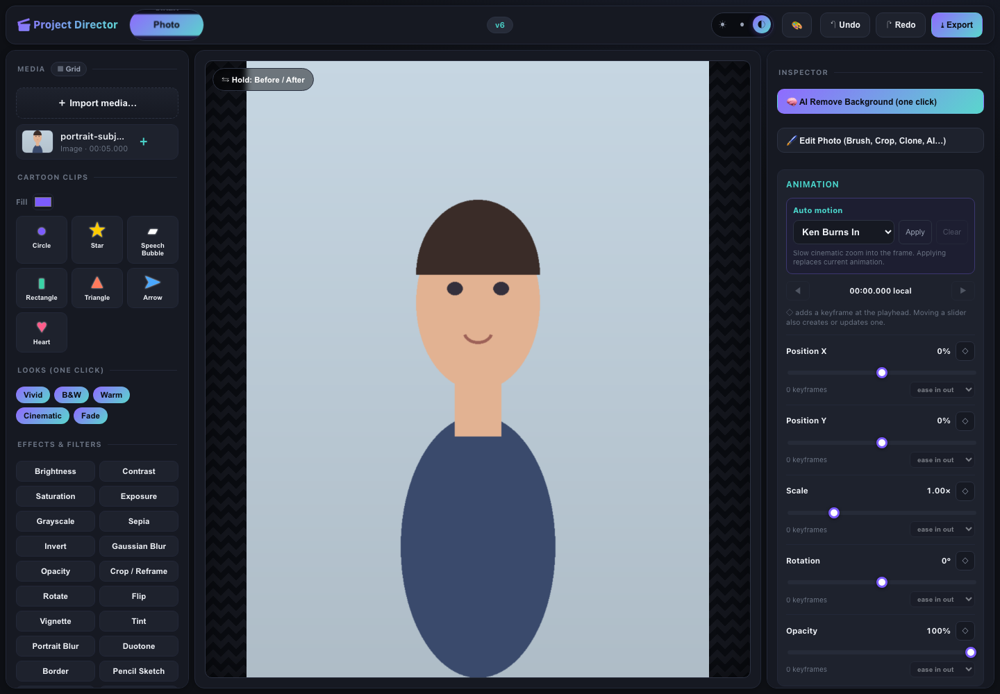

- **Point Color Precision Grading:** Sample any pixel with a 3D color cube
  dropper, adjust tolerance falloff in chromaticity space, shift
  Hue/Saturation/Luminance with feathered falloff, and isolate selections with
  range desaturation preview masks.
- **Defringe & Chromatic Aberration Correction:** Gradient-based high-contrast
  edge analysis that isolates and eliminates purple and green fringing along
  backlit contours.
- **Lens Optics & Vignetting Correction:** Polynomial radial distortion mapping
  to rectify barrel and pincushion lens distortion, paired with optical light
  falloff compensation with configurable midpoints.
- **Perspective Upright & Keystone Homography:** Full $3\times3$ projective
  homography transforms for vertical keystone tilt, horizontal tilt, rotation,
  aspect squeeze, and auto-scale.
- **Lens Blur & Optical Bokeh Simulation:** Depth-aware focal plane slicing with
  customizable aperture blade shapes (circular, 5-blade, 7-blade, 9-blade,
  cat-eye), optical blur radius, and specular highlight boost.
- **XMP Develop Preset Interchange:** Bidirectional import and export of native
  Adobe Camera Raw and Lightroom Develop Presets (`.xmp`).
- **Camera RAW / Lossless DNG:** Direct sensor Bayer demosaicing, black-level
  calibration, and camera white balance matrices:

  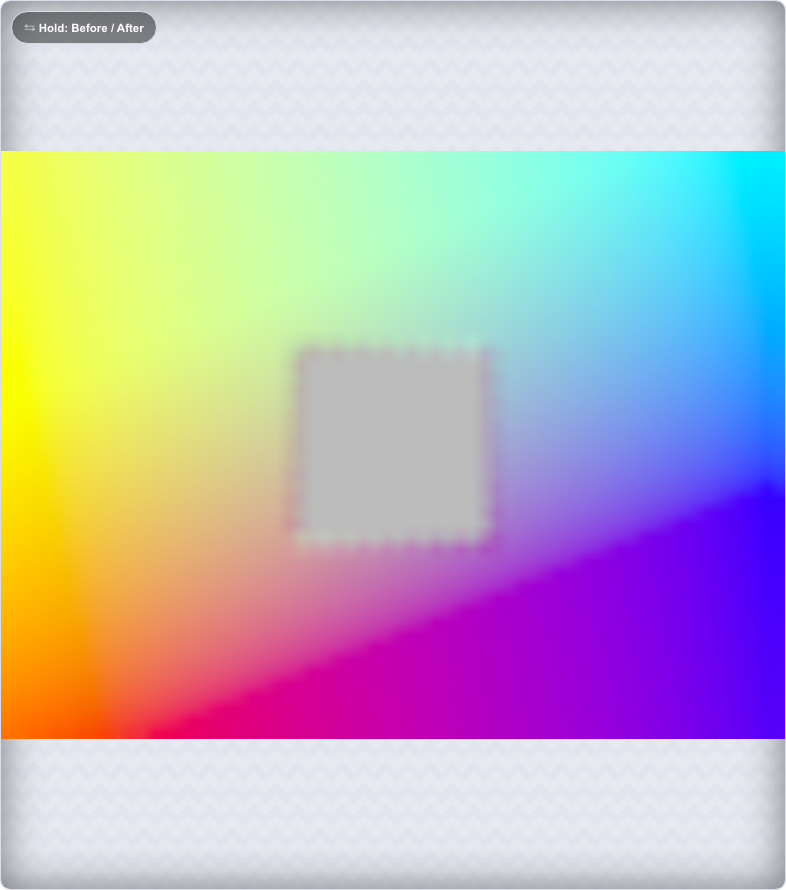

- **WebGL2 GPU 3D LUTs:** Hardware-accelerated `.cube` lookup table grading (9×
  faster rendering pass) with import and export:

  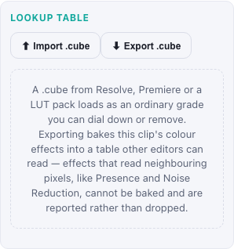

---

### CapCut Pro Style (Creative Audio, Video & Timeline)

High-speed social video creation and AI-driven timeline automation:

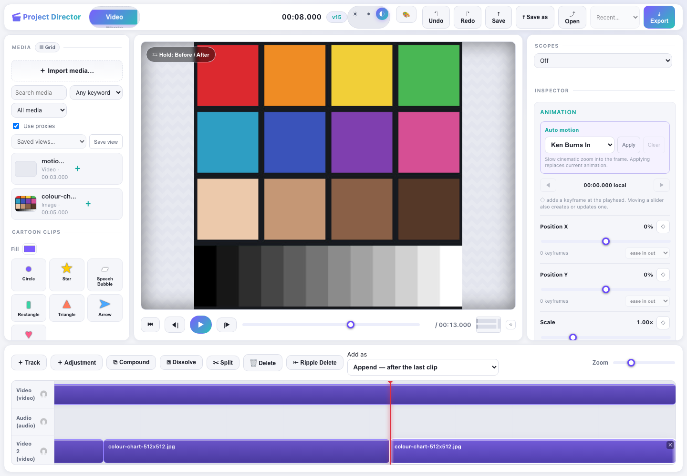

- **AI Color Match:** Harmonize multi-camera footage and mixed lighting setups
  with one-click perceptual color and luminance transfer from reference clips.
- **AI Beat Sync:** Analyze music waveform onset peaks and tempo, automatically
  generating rhythmic markers and snapping clip cuts to musical downbeats.
- **Auto-Captions & Subtitle Styling:** Automatic timed subtitle transcription
  with word-level accuracy, dynamic animation styles (karaoke, typewriter, pop),
  and SRT/WebVTT export.
- **Vocal Isolation & Speech Noise Reduction:** Separate human vocals from
  background music, produce instrumental backing tracks, and eliminate ambient
  room noise.
- **Video Deflicker & Exposure Smoothing:** Stabilize frame-to-frame exposure
  fluctuations caused by lighting PWM, time-lapse shutter variance, and
  strobing.
- **AI Smart Silence Cutter:** Scan dialogue for pauses and dead air,
  automatically generating ripple jump cuts with safety margins to tighten
  pacing.
- **Camera Stabilization & Feature Tracking:** Optical flow analysis canceling
  camera shake while preserving intended pans, alongside Lucas-Kanade feature
  tracking:

  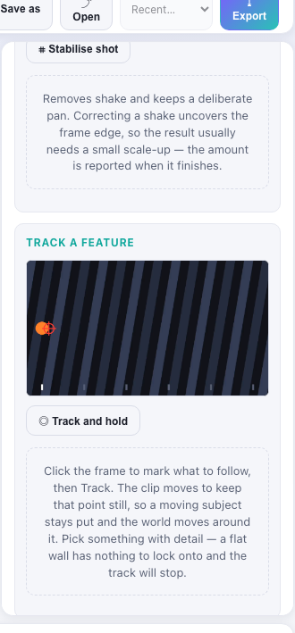

- **Keyboard-First Editing:** J/K/L shuttling with multi-speed forward and
  reverse playback, frame/second stepping, and `[` / `]` head/tail trimming.
- **Magnetic Tracks & Compounds:** Magnetic track packing (`🧲`), nested
  compound clips (`⧉ Compound`, `⤵ Open`, `⧈ Dissolve`), and three-point
  insert/overwrite editing.

---

### Canva Studio Style (Design, Publishing & Workflow)

Modern visual content creation, layout automation, and presentation tooling:

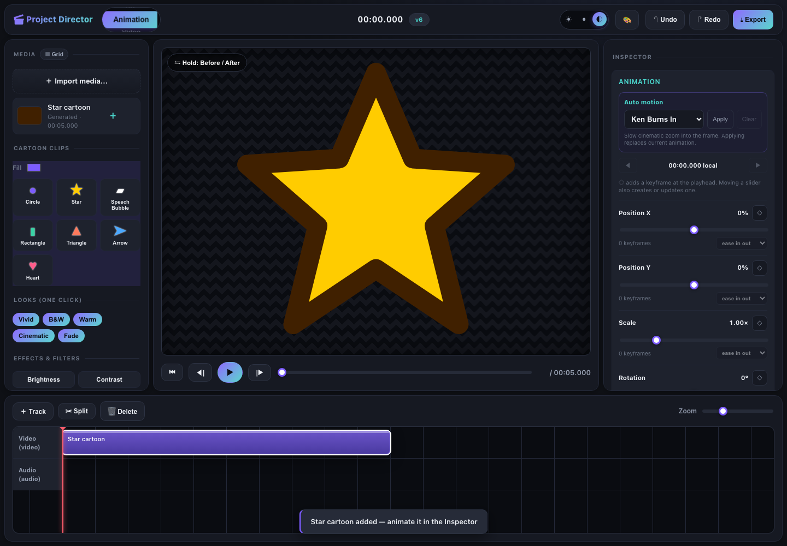

- **Screen & Webcam Recording Studio:** Record display, webcam, or combined
  picture-in-picture narration with countdown timers, audio level meters, and
  instant project placement.
- **System Eyedropper & Color Sampler:** High-precision pixel color sampling
  with RGB/HSL conversion, alpha transparency support, and palette history.
- **Multi-Tab Project Workspace:** Open and edit multiple projects
  simultaneously with tab groups, dirty indicators, thumbnail previews, and
  directional close options.
- **Export & Download Manager:** Non-blocking background export queue with
  progress tracking, cancellation, and retry.
- **Affinity Suite & Vector Recognition:** File format recognition for Serif
  Affinity (`.af`, `.afdesign`, `.afphoto`, `.afpub`), Photoshop (`.psd`),
  Illustrator (`.ai`), and vector graphics.
- **Proactive Memory Pressure Telemetry:** Live system memory monitoring with
  coordinated priority cache eviction to ensure smooth 4K editing.
- **Magic Aspect Ratio Adapter:** Intelligently reflow designs and video frames
  for Instagram, TikTok, YouTube, and LinkedIn with contain/cover modes and
  mobile UI safe margins.
- **Smart Brand Kits & Harmonies:** Store brand palettes, font pairings, and
  logos with automated WCAG 2.2 Level AA contrast compliance checks.
- **Presenter Mode & Speaker Notes:** Full-screen presentation mode with cue
  navigation, presenter stopwatch, speaker notes, interactive laser pointer
  trails, and spotlight aperture.
- **Offline Project Cache & Sync:** Work without an internet connection using
  local caching, mutation queueing, and deterministic reconnection replay.

---

## Track 2 — photo-editor (Python Application & Engine)

A non-destructive photo (and GIF/video) editor in Python. A single application
with a shared, serializable editing model — **35+ editing operations** that
apply equally to a single photo, a folder of photos, every frame of an animated
GIF, or every frame of a video.

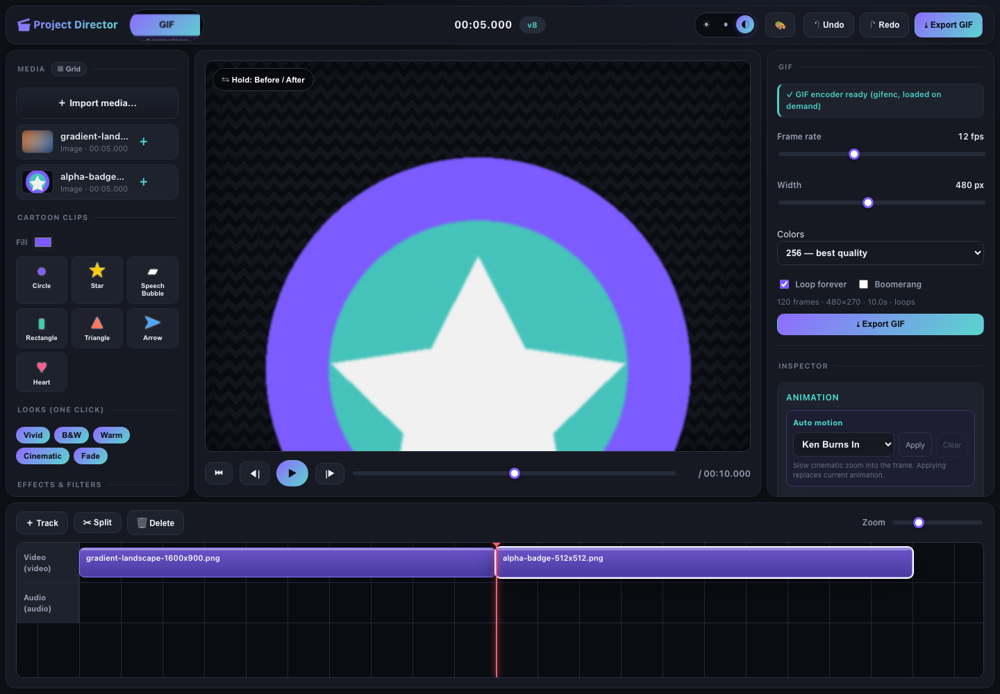

See [`PRO_DEVELOPMENT.md`](PRO_DEVELOPMENT.md) for the architecture and
design principles behind it.

- **`core/`** — GUI-agnostic engine: serializable `Operation` classes,
  `Document` with pointer-based undo/redo, and JSON recipes.
- **`plugins/`** — Drop-in `Operation` subclasses loaded at startup.
- **`cv_tools/`** — OpenCV + NumPy operations (CLAHE, denoise, unsharp mask,
  bilateral filter, inpainting).
- **`ai_tools/`** — AI operations (RMBG-1.4 background removal, YOLOv8
  auto-crop).
- **`video_tools/`** — MoviePy/FFmpeg video processing.
- **`photo_editor.py`** — Tkinter graphical desktop editor.
- **`app.py`** — Unified CLI entry point for images, batch folders, GIFs, and
  videos.

---

## Example Image Editing Options & Real-World Workflows

Both Track 1 (Web Studio) and Track 2 (Python Engine) provide deterministic,
high-precision editing operations. Below are real-world animal and wildlife
examples showcasing **Before & After editing side-by-side**:

---

### 1. AI Subject Segmentation & Background Cutout (Lion Cub)

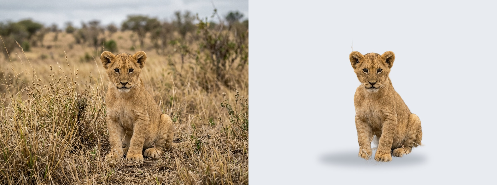

Extract foreground subjects with fine edge preservation:

- **One-Click Cutout:** Neural segmentation models isolate the baby lion cub
  from cluttered outdoor scrub onto a clean neutral studio backdrop.
- **Whisker & Fur Detail:** Sub-pixel alpha matte transitions preserve fine
  flyaway hairs and whiskers without harsh clipping artifacts.
- **Chroma Spill Suppression:** Neutralize unwanted color bounce from
  background foliage, preserving natural coat colors.

---

### 2. Optical Lens Blur & Depth-of-Field Bokeh (Tiger Cub)

| Before (Deep Focus & Distracting Clutter) | After (9-Blade Optical Bokeh Simulation) |
| :---: | :---: |
| 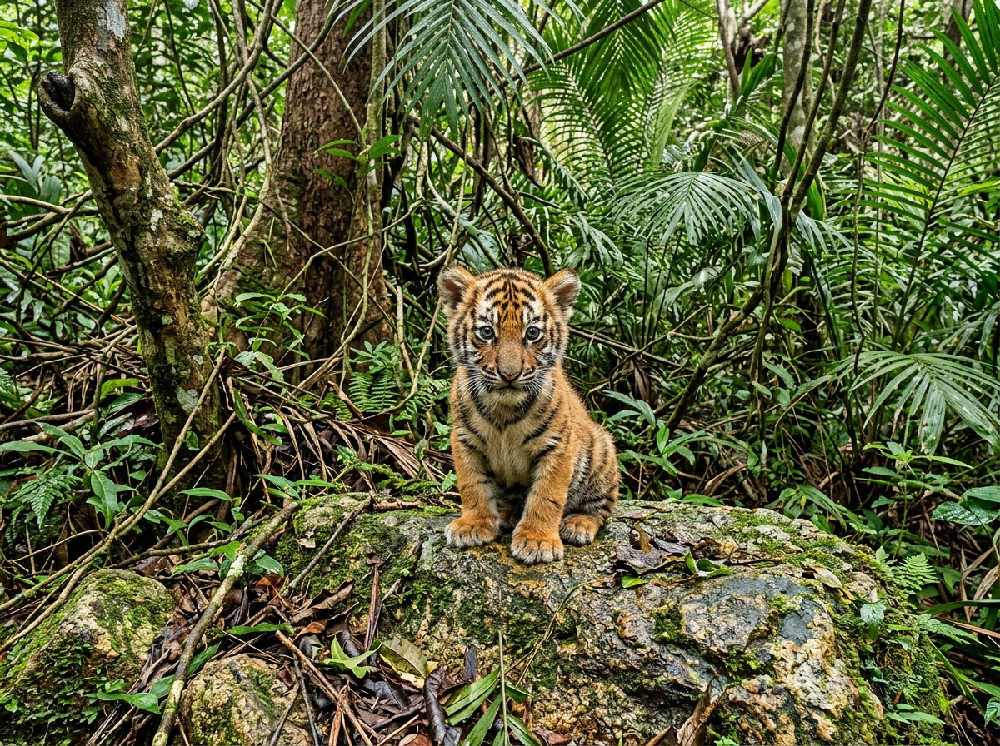 | 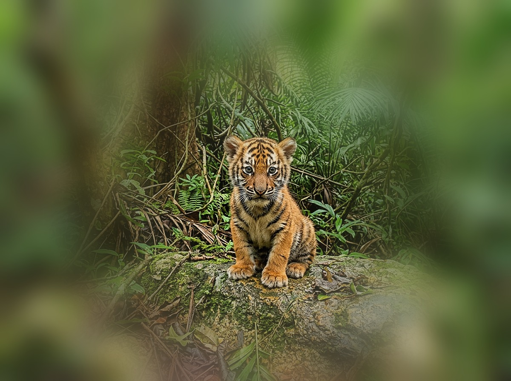 |

Transform distracting backgrounds into creamy optical depth of field:

- **Focal Plane Slicing:** Isolate the baby tiger cub in pin-sharp focus on the
  mossy rock while calculating depth falloff across the foliage.
- **Aperture Geometry:** Render realistic 9-blade optical bokeh with circular
  specular light discs in place of harsh background branches.
- **Highlight Boost:** Specular highlight boost illuminates light filtering
  through the forest canopy.

---

### 3. Golden Hour Tone Curves & Fur Vibrance (Lion Cub)

| Before (Flat Overcast Daylight) | After (Golden-Hour Vibrance & Tone Curve) |
| :---: | :---: |
| 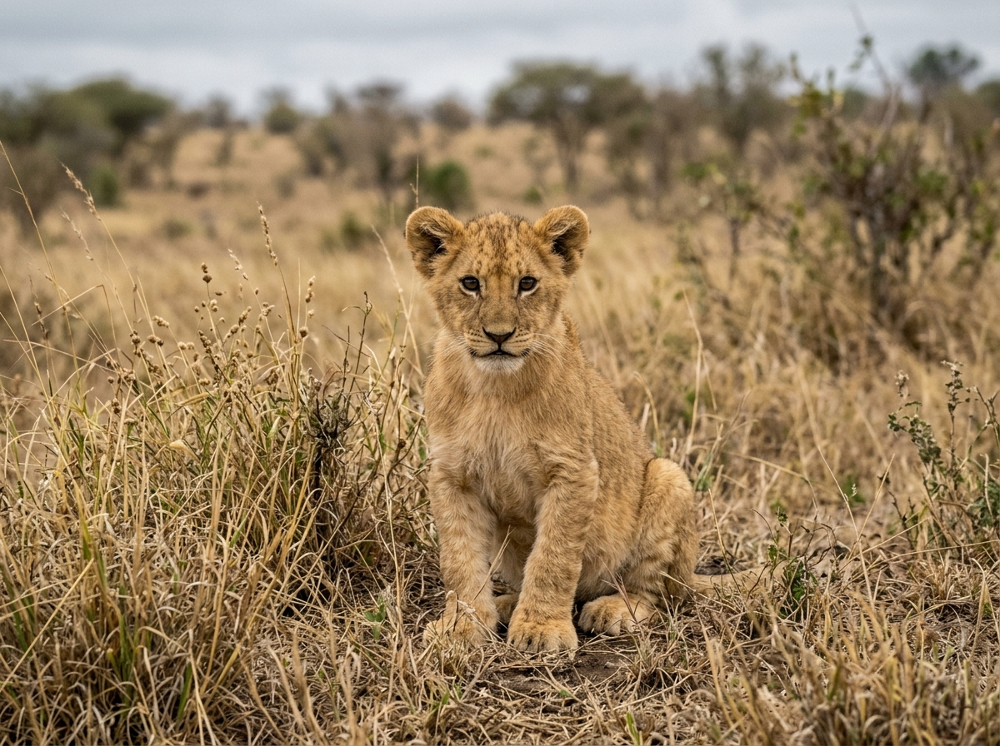 | 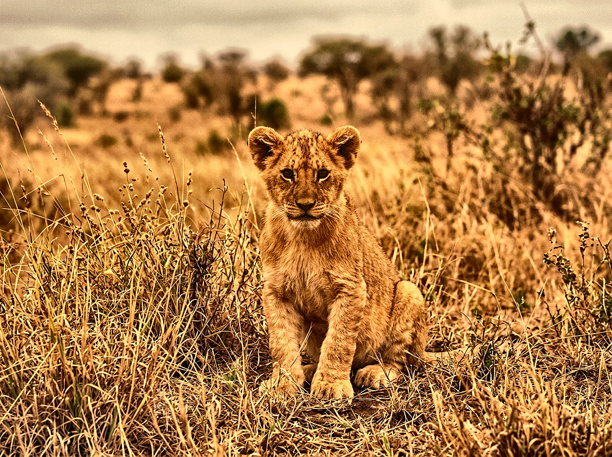 |

Bring warmth, dimension, and life to flat wildlife captures:

- **Tone (Light) Controls:** Lift deep shadows in the cub's fur while
  protecting bright highlights in the tall grasses.
- **Vibrance & Color Temperature:** Warm the scene toward amber golden-hour
  lighting while intensifying eye clarity and fur saturation.
- **Multi-Band Curves:** Fine-tune RGB contrast along a gentle S-curve for
  punchy depth without crushing blacks.

---

### 4. Cinematic 3D LUT Color Science & Split-Toning (Tiger Cub)

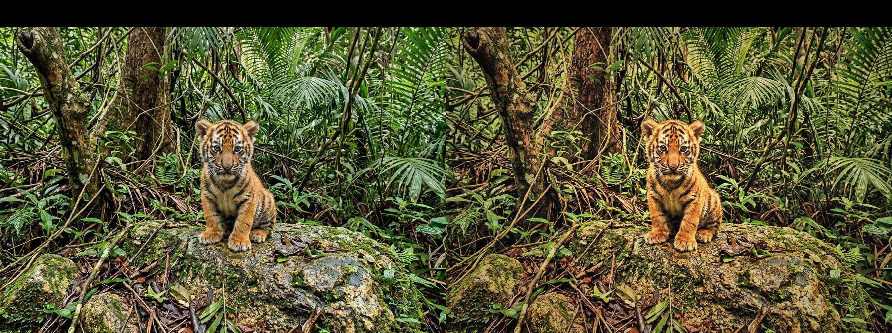

Grade high-dynamic-range scenes with GPU-accelerated color transforms:

- **Hardware Acceleration:** Apply complex 3D LUT grids on the GPU via WebGL2
  in a single fast pass (~9× faster than CPU raster rendering).
- **Split Toning:** Infuse golden amber warmth into the tiger cub's coat while
  casting complementary deep teal hues into the forest shadows.
- **LUT Interchange:** Import `.cube` lookup tables from DaVinci Resolve or
  export custom grades to reuse across projects.

---

### 5. Precision Point Color & Targeted HSL Selection


Isolate specific colors in chromaticity space without shifting surrounding
tones:

- **Targeted Color Sampling:** Click with the 3D color cube eyedropper onto the
  vehicle body to capture its target center in chromaticity space.
- **Tolerance & Falloff Control:** Restrict the color selection window to
  include highlights while cleanly excluding the yellow plate and background
  facades.
- **Selective HSL Offset:** Shift the hue with smooth feathered falloff.
- **Range Desaturation Verification:** Temporarily desaturate unselected pixels
  to verify mask boundaries before applying.

---

### 6. Architectural Perspective Upright & Keystone Correction

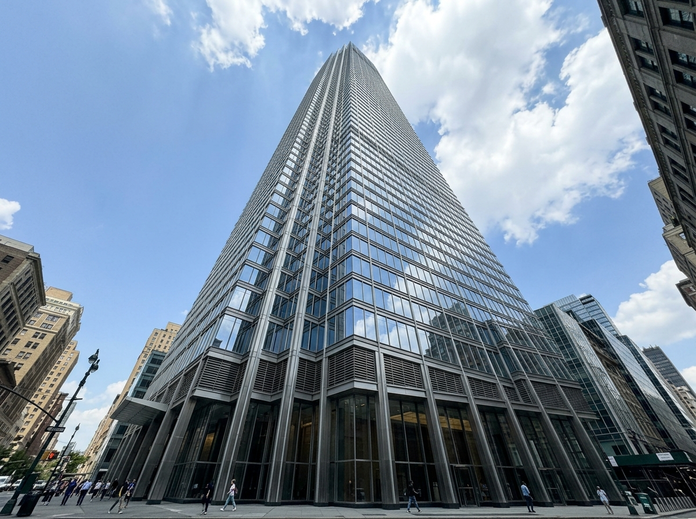

Correct extreme wide-angle lens convergence on architectural subjects:

- **Projective Homography ($3\times3$):** Upright automatically models
  projective geometry using affine and projective constraints.
- **Vertical & Horizontal Keystone:** Counteract vertical convergence from low
  ground angles, aligning building lines parallel to the frame borders.
- **Aspect Squeeze & Scale:** Compensate for optical foreshortening and auto-crop
  the resulting corner voids.

---

### 7. Python JSON Recipe Automation

Save any multi-step editing grade as a portable, serializable JSON recipe:

```json
[
  { "op": "AutoWhiteBalance" },
  { "op": "CLAHE", "params": { "clip_limit": 2.5, "tile_grid": 8 } },
  { "op": "Highlights", "params": { "amount": -20 } },
  { "op": "Shadows", "params": { "amount": 15 } },
  { "op": "Vibrance", "params": { "amount": 25 } },
  { "op": "UnsharpMask", "params": { "radius": 1.5, "amount": 0.8 } }
]
```

Apply the recipe across single images or entire photo sets via CLI:
```bash
python app.py batch look.json input_photos/ output_photos/
```

---

## Quick Start & Installation

### Web Studio (Track 1 — TypeScript & Rust)

Requirements: Node.js 20+ and pnpm 9.

```bash
# Install dependencies
pnpm install

# Run the local web studio
pnpm dev
# Alternatively: pnpm --filter @director/web dev
```
Open `http://localhost:5173/` in any modern desktop browser (Chromium
recommended for WebCodecs MP4 export).

### Python Application (Track 2)

Requirements: Python 3.10+.

```bash
# Core dependencies (Pillow + Tkinter GUI support)
pip install -r requirements.txt

# Optional modules:
pip install -r requirements-cv.txt      # OpenCV / NumPy (CLAHE, denoise, unsharp)
pip install -r requirements-ai.txt      # AI models (RMBG-1.4, YOLOv8)
pip install -r requirements-video.txt   # Video engine (MoviePy / FFmpeg)
pip install -r requirements-raw.txt     # Camera RAW decode (rawpy)
pip install -r requirements-dev.txt     # Full test suite + pytest
```

---

## Python CLI Usage (`app.py`)

A single command interface handles images, directories, animations, and videos:

```bash
python app.py gui                                   # Launch graphical Tkinter editor
python app.py list-ops                              # Print all 35+ registered operations
python app.py image  look.json photo.jpg out.png    # Apply recipe to one image
python app.py batch  look.json in_dir/ out_dir/     # Apply recipe to an entire folder
python app.py gif    look.json in.gif  out.gif      # Apply recipe to every GIF frame
python app.py video  look.json in.mp4  out.mp4      # Apply recipe to every video frame
python app.py build  slideshow.gif *.jpg --duration 500              # Stills -> GIF
python app.py build  clip.mp4 frames/*.png --fps 24 --recipe look.json # Stills -> MP4
python app.py togif  clip.mp4 out.gif --start 3 --end 8 --fps 12     # Video -> GIF
python app.py togif  clip.mp4 loop.gif --size 480 270 --boomerang     # Ping-pong GIF
```

---

## Monorepo Workspace Structure

```
apps/
  web/                     # Browser editor (Vite + WebGL2 + WebCodecs)
  desktop/                 # Native desktop shell scaffold
  api/                     # Headless API scaffold
packages/
  canonical-json/          # Byte-equivalent canonical JSON serializer
  command-schema/          # Discriminated command unions & inverse commands
  project-schema/          # Zod schema definitions for project models
  editor-state/            # Reversible command engine, history, undo/redo
  raster-tools/            # Image adjustments, tone curves, LUTs, and masks
  playback-controller/     # Timeline engine, clock, and audio envelopes
  export-engine/           # WebCodecs H.264/WebM render pipeline
  motion-tracking/         # Lucas-Kanade optical flow stabilization
  raw-decode/              # DNG, TIFF, and lossless JPEG raw decoder
  bg-segmentation/         # AI background segmentation pipeline
  ui-kit/                  # Reusable timeline & editing widgets
crates/
  media-core/              # Rust pixel, colorspace, and buffer primitives
  timeline-engine/         # Pure Rational interval primitives
  project-store/           # Canonical microsecond in-memory project store
core/                      # Python editing engine & operation registry
cv_tools/                  # OpenCV filters & computer vision operations
ai_tools/                  # Deep learning segmentation & detection tools
video_tools/               # MoviePy / FFmpeg video processing pipeline
docs/                      # Architecture ADRs, roadmap, user manual
```

---

## Testing & Verification Gates

Run the verification suite across all layers:

```bash
# TypeScript workspace checks
pnpm format:check          # Prettier code formatting
pnpm lint                  # ESLint analysis
pnpm typecheck             # TypeScript strict type checking
pnpm test                  # Vitest unit & integration tests (1500+ tests)
pnpm build                 # Monorepo build

# Rust crate checks
cargo fmt --check
cargo clippy --workspace --all-targets -- -D warnings
cargo test --workspace

# User manual synchronization check
pnpm manual:check

# Python tests (headless)
pytest
```

---

## Non-Negotiable Core Rules

1. **Original media is never modified.** Exports are generated as new files.
2. **Commands are the only public project mutation path.**
3. **Raw input is validated (Zod)** prior to state mutation.
4. **Rejected commands are strictly atomic:** rejected operations leave state
   deeply equal with no history alteration.
5. **Reducer inputs are immutable:** caller-owned objects are never mutated.
6. **Pure determinism:** reducers and replay never query clocks, generate random
   IDs, perform I/O, or use locale-dependent ordering.
7. **Canonical timestamps:** persisted time is a canonical decimal string of
   nonnegative integer microseconds (`^(0|[1-9][0-9]*)$`).
8. **JSON serializability:** all project states and command operations are
   serializable.
9. **Replay equivalence:** the same operation log replays to byte-equivalent
   canonical JSON.
10. **Linear redo:** new commands after an undo clear the redo branch.
